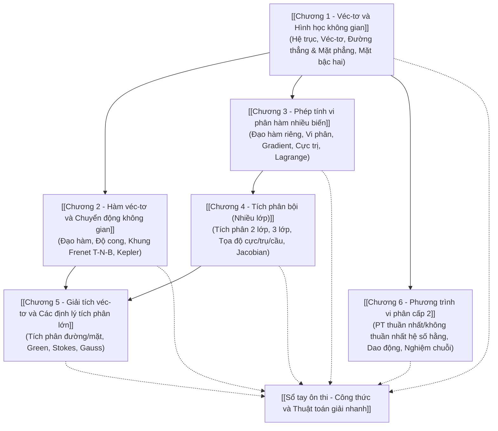

# MOC - Giải tích 2 (Calculus II)

> [!abstract] Tổng quan môn học
> Môn **Giải tích 2** (VNU-UET) phát triển phép tính vi phân và tích phân từ không gian 1 chiều lên không gian đa chiều ($\mathbb{R}^2, \mathbb{R}^3, \mathbb{R}^n$), đỉnh cao là **các định lý tích phân lớn (Green, Stokes, Gauss)** và **phương trình vi phân cấp 2**.

---

## 🗺️ Bản đồ nội dung (Mindmap liên kết)

---

## 📚 Hệ thống ghi chú chi tiết

1. [[Chương 1 - Véc-tơ và Hình học không gian]]
   - Tọa độ 3D, tích vô hướng $\mathbf{a} \cdot \mathbf{b}$, tích có hướng $\mathbf{a} \times \mathbf{b}$.
   - Phương trình tham số đường thẳng, phương trình tổng quát mặt phẳng, khoảng cách.
   - Các mặt bậc hai chính quy: Ellipsoid, Hyperboloid (1 tầng, 2 tầng), Paraboloid (elliptic, hyperbolic), Mặt nón.

2. [[Chương 2 - Hàm véc-tơ và Chuyển động không gian]]
   - Hàm véc-tơ $\mathbf{r}(t)$, vận tốc $\mathbf{v}(t)$, gia tốc $\mathbf{a}(t)$.
   - Độ dài cung $s(t)$, độ cong $\kappa$, véc-tơ tiếp tuyến $\mathbf{T}$, pháp tuyến chính $\mathbf{N}$, song pháp tuyến $\mathbf{B}$.
   - Mặt phẳng mật tiếp (osculating), mặt phẳng pháp tuyến.
   - Phân tích gia tốc: $\mathbf{a} = a_T \mathbf{T} + a_N \mathbf{N}$.

3. [[Chương 3 - Phép tính vi phân hàm nhiều biến]]
   - Giới hạn và tính liên tục (phương pháp 2 đường cong, kẹp).
   - Đạo hàm riêng, vi phân toàn phần $dz$, xấp xỉ tuyến tính và mặt phẳng tiếp xúc.
   - Quy tắc chuỗi (Chain Rule), đạo hàm hàm ẩn.
   - Đạo hàm theo hướng $D_{\mathbf{u}}f$ và Gradient $\nabla f$ (hướng tăng nhanh nhất).
   - Cực trị tự do (ma trận Hessian, biệt thức $D = AC - B^2$).
   - Cực trị có điều kiện (Nhân tử Lagrange: $\nabla f = \lambda \nabla g$).

4. [[Chương 4 - Tích phân bội (Nhiều lớp)]]
   - Tích phân 2 lớp $\iint_D f(x,y)\,dA$: Định lý Fubini, đổi thứ tự lấy tích phân.
   - Tọa độ cực ($x = r\cos\theta, y = r\sin\theta, dA = r\,dr\,d\theta$).
   - Diện tích mặt $z = f(x,y)$: $dS = \sqrt{1 + (f_x)^2 + (f_y)^2}\,dA$.
   - Tích phân 3 lớp $\iiint_E f(x,y,z)\,dV$: Chiếu theo trục $z$ hoặc mặt phẳng.
   - Tọa độ trụ và tọa độ cầu ($dV = \rho^2 \sin\phi\,d\rho\,d\phi\,d\theta$).
   - Công thức đổi biến tổng quát (Định thức Jacobian $J$).

5. [[Chương 5 - Giải tích véc-tơ và Các định lý tích phân lớn]]
   - Trường véc-tơ, tích phân đường loại 1 (độ dài cung) và loại 2 (công cơ học).
   - Trường bảo toàn (thế vị): điều kiện $\text{rot}\,\mathbf{F} = \mathbf{0}$, tìm hàm thế vị $f$.
   - Định lý Green trên mặt phẳng (liên hệ tích phân đường đóng và tích phân 2 lớp).
   - Toán tử vi phân trường véc-tơ: Curl ($\text{rot}$) và Divergence ($\text{div}$).
   - Tích phân mặt loại 1 (diện tích) và loại 2 (thông lượng flux qua mặt định hướng).
   - **Định lý Stokes**: $\oint_C \mathbf{F} \cdot d\mathbf{r} = \iint_S (\text{curl}\,\mathbf{F}) \cdot d\mathbf{S}$.
   - **Định lý Gauss (Divergence Theorem)**: $\iint_S \mathbf{F} \cdot d\mathbf{S} = \iiint_E (\text{div}\,\mathbf{F})\,dV$.

6. [[Chương 6 - Phương trình vi phân cấp 2]]
   - Tuyến tính cấp 2 thuần nhất: $ay'' + by' + cy = 0$ (nghiệm thực phân biệt, nghiệm kép, nghiệm phức).
   - Tuyến tính cấp 2 không thuần nhất: Phương pháp hệ số bất định & phương pháp biến thiên hằng số.
   - Ứng dụng dao động cơ học (điều hòa, tắt dần, cưỡng bức, cộng hưởng) và mạch RLC.
   - Phương pháp tìm nghiệm dạng chuỗi lũy thừa $\sum_{n=0}^\infty c_n x^n$.

7. [[Sổ tay ôn thi - Công thức và Thuật toán giải nhanh]]
   - Bảng tra cứu công thức bỏ túi trước giờ thi.
   - Ma trận phân loại đề thi & bẫy trắc nghiệm/tự luận.
   - Thuật toán giải nhanh cho từng dạng bài trọng tâm.

---

## 🎯 Chiến lược ôn thi điểm cao (A / A+)

| Giai đoạn | Trọng tâm | File cần xem |
|---|---|---|
| **Tuần 1: Nền tảng** | Véc-tơ không gian, vi phân nhiều biến, cực trị tự do & Lagrange | [[Chương 1 - Véc-tơ và Hình học không gian]], [[Chương 2 - Hàm véc-tơ và Chuyển động không gian]], [[Chương 3 - Phép tính vi phân hàm nhiều biến]] |
| **Tuần 2: Tích phân bội & Trường** | Kỹ năng chia miền tích phân 2/3 lớp, tọa độ cầu/trụ, tích phân đường/mặt | [[Chương 4 - Tích phân bội (Nhiều lớp)]], [[Chương 5 - Giải tích véc-tơ và Các định lý tích phân lớn]] |
| **Tuần 3: Đỉnh cao & Về đích** | Master bộ 3 định lý Green-Stokes-Gauss, giải PTVP cấp 2, luyện đề | [[Chương 6 - Phương trình vi phân cấp 2]], [[Sổ tay ôn thi - Công thức và Thuật toán giải nhanh]] |
