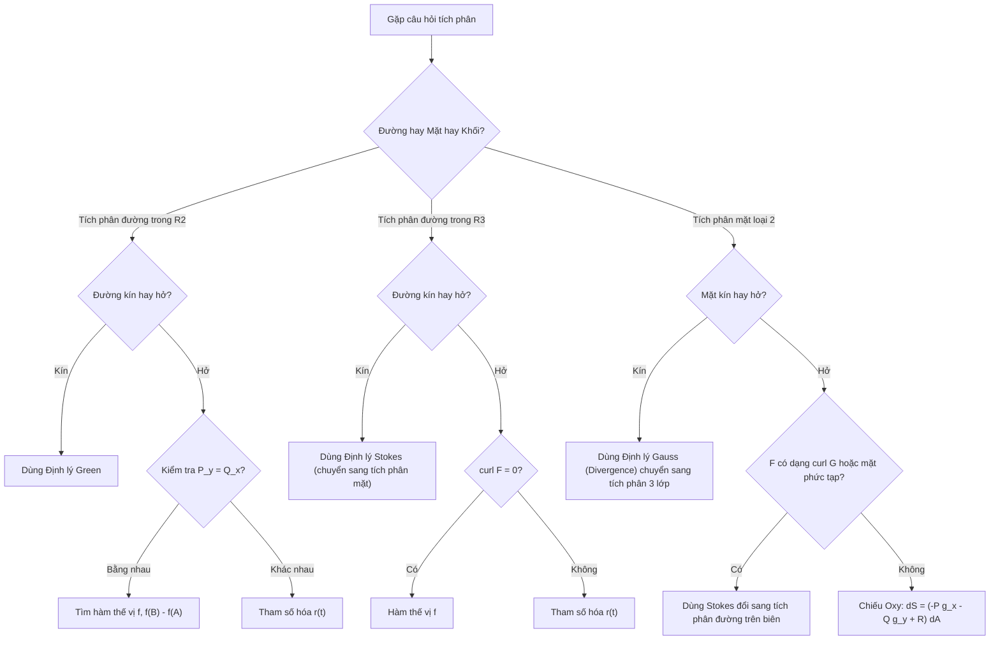

# Sổ tay ôn thi - Công thức và Thuật toán giải nhanh

Quay lại: [[MOC - Giải tích 2]]

> [!abstract] Mục đích tài liệu
> Sổ tay tra cứu thần tốc trước giờ thi môn **Giải tích 2**: tóm gọn toàn bộ công thức tính nhanh, thuật toán chọn công cụ giải quyết bài toán và danh sách bẫy thi dễ mất điểm nhất.

---

## ⚡ Bảng tra cứu công thức vàng (Cheat Sheet)

### 1. Hình học vi phân & Khung Frenet
| Đại lượng | Ký hiệu | Công thức tính nhanh |
|---|---|---|
| Độ dài cung | $L$ | $\int_a^b \|\mathbf{r}'(t)\|\,dt$ |
| Độ cong | $\kappa$ | $\frac{\|\mathbf{r}'(t) \times \mathbf{r}''(t)\|}{\|\mathbf{r}'(t)\|^3}$ |
| Tiếp tuyến đơn vị | $\mathbf{T}$ | $\frac{\mathbf{r}'(t)}{\|\mathbf{r}'(t)\|}$ |
| Song pháp tuyến | $\mathbf{B}$ | $\frac{\mathbf{r}'(t) \times \mathbf{r}''(t)}{\|\mathbf{r}'(t) \times \mathbf{r}''(t)\|}$ |
| Pháp tuyến chính | $\mathbf{N}$ | $\mathbf{B} \times \mathbf{T}$ |
| Bán kính cong | $\rho$ | $\frac{1}{\kappa}$ |
| Gia tốc tiếp tuyến | $a_T$ | $\frac{\mathbf{r}' \cdot \mathbf{r}''}{\|\mathbf{r}'\|}$ |
| Gia tốc pháp tuyến | $a_N$ | $\frac{\|\mathbf{r}' \times \mathbf{r}''\|}{\|\mathbf{r}'\|} = \sqrt{\|\mathbf{a}\|^2 - a_T^2}$ |

---

### 2. Vi phân hàm nhiều biến & Tối ưu
| Khái niệm | Công thức / Tiêu chuẩn |
|---|---|
| Xấp xỉ tuyến tính | $L(x,y) = f(x_0, y_0) + f_x(x_0, y_0)(x - x_0) + f_y(x_0, y_0)(y - y_0)$ |
| Mặt phẳng tiếp xúc $z = f(x,y)$ | $z - z_0 = f_x(x_0, y_0)(x - x_0) + f_y(x_0, y_0)(y - y_0)$ |
| Pháp tuyến mặt mức $F(x,y,z) = c$ | $\mathbf{n} = \nabla F(x_0, y_0, z_0) = \langle F_x, F_y, F_z \rangle$ |
| Đạo hàm theo hướng | $D_{\mathbf{u}}f = \nabla f \cdot \mathbf{u} \quad (\|\mathbf{u}\| = 1)$ |
| Tốc độ tăng cực đại | $\max D_{\mathbf{u}}f = \|\nabla f\|$, đạt được khi $\mathbf{u} = \frac{\nabla f}{\|\nabla f\|}$ |
| Biệt thức Hessian | $D = f_{xx} f_{yy} - (f_{xy})^2$. ($D>0, f_{xx}>0 \implies$ CT; $D>0, f_{xx}<0 \implies$ CĐ; $D<0 \implies$ Yên ngựa) |
| Nhân tử Lagrange | $\nabla f = \lambda \nabla g \quad \text{với ràng buộc } g(x,y,z) = k$ |

---

### 3. Tích phân bội & Jacobian
| Tọa độ | Biến đổi | Yếu tố vi phân diện tích / thể tích ($dA$ / $dV$) |
|---|---|---|
| Cực | $x = r\cos\theta, y = r\sin\theta$ | $dA = r\,dr\,d\theta$ |
| Trụ | $x = r\cos\theta, y = r\sin\theta, z = z$ | $dV = r\,dz\,dr\,d\theta$ |
| Cầu | $x = \rho\sin\phi\cos\theta, y = \rho\sin\phi\sin\theta, z = \rho\cos\phi$ | $dV = \rho^2 \sin\phi\,d\rho\,d\phi\,d\theta$ |
| Diện tích mặt $z = g(x,y)$ | $dS = \sqrt{1 + g_x^2 + g_y^2}\,dA$ | |

---

### 4. Giải tích véc-tơ & Bộ ba định lý lớn
| Định lý | Công thức liên hệ | Điều kiện áp dụng |
|---|---|---|
| **Green** | $\oint_C P\,dx + Q\,dy = \iint_D \left(\frac{\partial Q}{\partial x} - \frac{\partial P}{\partial y}\right)dA$ | $C$ kín, phẳng, ngược chiều kim đồng hồ |
| **Stokes** | $\oint_C \mathbf{F} \cdot d\mathbf{r} = \iint_S (\text{curl}\,\mathbf{F}) \cdot d\mathbf{S}$ | $C$ kín không gian, $S$ tựa lên $C$, quy tắc bàn tay phải |
| **Gauss (Divergence)** | $\iint_S \mathbf{F} \cdot d\mathbf{S} = \iiint_E (\text{div}\,\mathbf{F})\,dV$ | $S$ là mặt **kín** bao quanh khối $E$, pháp tuyến hướng **ra ngoài** |
| **Trường bảo toàn** | $\int_C \nabla f \cdot d\mathbf{r} = f(B) - f(A)$ | $\text{curl}\,\mathbf{F} = \mathbf{0}$, độc lập đường đi |

---

### 5. Phương trình vi phân cấp 2: $a y'' + b y' + c y = G(x)$
- **Nghiệm tổng quát**: $y = y_h + y_p$.
- **Phương trình đặc trưng**: $a r^2 + b r + c = 0$.
  - $\Delta > 0 \implies y_h = c_1 e^{r_1 x} + c_2 e^{r_2 x}$.
  - $\Delta = 0 \implies y_h = (c_1 + c_2 x) e^{r x}$.
  - $\Delta < 0 \implies y_h = e^{\alpha x} (c_1 \cos\beta x + c_2 \sin\beta x)$ với $r = \alpha \pm i\beta$.
- **Nghiệm riêng theo biến thiên hằng số**:
  $$y_p = -y_1 \int \frac{y_2 G(x)}{a W}\,dx + y_2 \int \frac{y_1 G(x)}{a W}\,dx, \quad W = y_1 y_2' - y_2 y_1'$$

---

## 🧭 Cây quyết định chọn công cụ giải (Decision Tree)

---

## ⚠️ Top 6 bẫy thi thường gặp nhất (Tránh mất điểm oan)

1. **Quên chuẩn hóa véc-tơ hướng $u$ khi tính đạo hàm theo hướng**:
   - *Sai*: Lấy luôn $\nabla f \cdot \mathbf{v}$.
   - *Đúng*: Phải chia độ dài $\mathbf{u} = \frac{\mathbf{v}}{\|\mathbf{v}\|}$, sau đó $D_{\mathbf{u}}f = \nabla f \cdot \mathbf{u}$.

2. **Quên nhân thêm $r$ trong tọa độ cực và trụ, $\rho^2 \sin\phi$ trong tọa độ cầu**:
   - Tọa độ cực: $dA = r\,dr\,d\theta$.
   - Tọa độ trụ: $dV = r\,dz\,dr\,d\theta$.
   - Tọa độ cầu: $dV = \rho^2 \sin\phi\,d\rho\,d\phi\,d\theta$.
   - Quên là kết quả sai hoàn toàn từ bước đầu!

3. **Chiều đường cong trong Định lý Green & Stokes**:
   - Chiều chuẩn là **ngược chiều kim đồng hồ** (định hướng dương). Nếu đề cho "theo chiều kim đồng hồ", phải thêm dấu trừ đằng trước kết quả.

4. **Hướng pháp tuyến trong Tích phân mặt & Định lý Gauss**:
   - Định lý Gauss yêu cầu mặt $S$ đóng có pháp tuyến hướng **ra ngoài** (outward). Nếu đề bảo "hướng vào trong" (inward) $\implies$ đổi dấu kết quả.
   - Khi chiếu mặt $z = g(x,y)$, nếu pháp tuyến hướng **xuống dưới** $\implies$ đổi dấu cụm $(-P g_x - Q g_y + R)$.

5. **Trường hợp mặt hở muốn dùng Định lý Gauss**:
   - Nếu mặt $S$ hở (ví dụ bán cầu trên không có đáy), **không được áp dụng trực tiếp Gauss**.
   - *Cách giải chuẩn*: Đậy nắp đáy $S_1$ (hình tròn $z=0$) để được mặt kín $S \cup S_1$. Khi đó:
     $$\iint_S = \iiint_E (\text{div}\,\mathbf{F})\,dV - \iint_{S_1} \mathbf{F}\cdot d\mathbf{S}_1$$

6. **Bậc của $s$ trong phương pháp hệ số bất định (PTVP cấp 2)**:
   - Nghiệm riêng $y_p = x^s \dots$ phải kiểm tra số lần $\alpha$ hoặc $\alpha \pm i\beta$ trùng với nghiệm phương trình đặc trưng. Trùng 1 lần thì $s=1$, trùng kép thì $s=2$. Quên nhân $x^s$ sẽ dẫn đến phương trình đồng nhất vô nghiệm.
