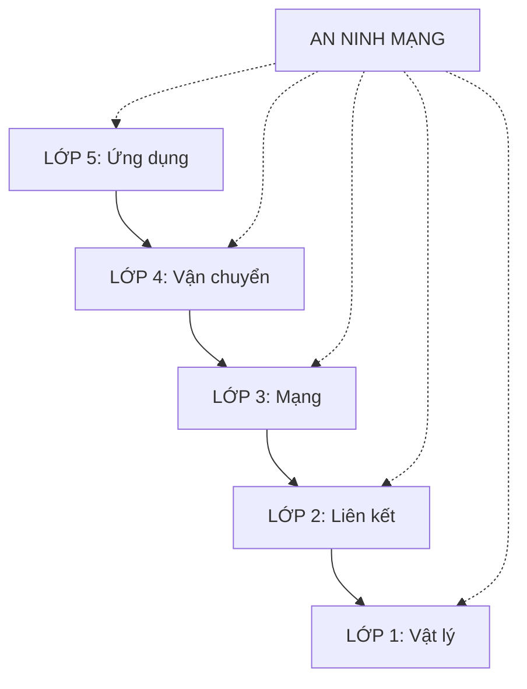

# MỤC LỤC - Lý thuyết Mạng máy tính (Kurose & Ross 9th ed.)

> Hệ thống hóa từ slide giảng dạy Computer Networking: A Top-Down Approach

---

## Các chương

| Chương | File | Chủ đề |
|--------|------|--------|
| 1 | [[Chương 1 - Giới thiệu]] | Internet, giao thức, cạnh/lõi mạng, hiệu suất, mô hình lớp |
| 2 | [[Chương 2 - Lớp Ứng dụng]] | HTTP, DNS, Email, P2P, Video/CDN, Socket |
| 3 | [[Chương 3 - Lớp Vận chuyển]] | UDP, TCP, Flow/Congestion Control |
| 4 | [[Chương 4 - Lớp Mạng]] | IPv4/v6, Routing (OSPF/BGP), Router, SDN, NAT |
| 5 | [[Chương 5 - Lớp Liên kết & LAN]] | Ethernet, Switch, VLAN, WiFi, MPLS, Data Center |
| 6 | [[Chương 6 - Mạng không dây & Di động]] | WiFi 4/5/6/7, MIMO, WPA2/3, 4G LTE, 5G NR |
| 7 | [[Chương 7 - An ninh mạng]] | Crypto, PKI, TLS 1.3, IPsec, Firewall, IDS/IPS |

---

## Sơ đồ tổng quan

---

## Tài liệu gốc
- **Sách**: Computer Networking: A Top-Down Approach, 9th Edition - Kurose & Ross (Pearson, 2025)
- **Slide**: 8 chương PPTX (Chapter 1-8 v9.0)
- **Ngày tạo**: 2026-11-10

---

*Mỗi chương là một file `.md` riêng biệt trong thư mục này. Dùng wiki-link `[[...]]` để điều hướng.*