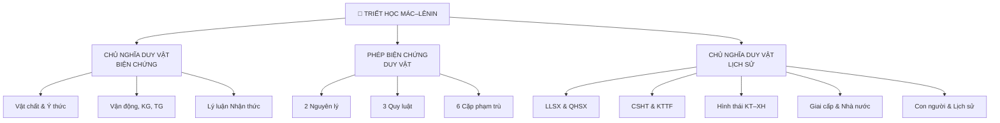

---
tags:
  - triết-học
  - dashboard
  - mác-lênin
date: 2026-11-12
aliases:
  - Triết Học Hub
  - triết dashboard
---

# 🧠 Triết học Mác – Lênin · Dashboard

> [!tip] Hướng dẫn dùng
> Đây là trung tâm điều hướng. Bắt đầu ở đây mỗi buổi học.

---

## 📌 Trạng thái học tập

| Chủ đề | Note | Trạng thái |
|---|---|---|
| Khái luận Triết học | [[01 - Khái luận về Triết học]] | ✅ Đã học |
| Sự ra đời Triết học Mác-Lênin | [[02 - Sự ra đời Triết học Mác-Lênin]] | ✅ Đã học |
| Chủ nghĩa Duy vật Biện chứng | [[03 - Chủ nghĩa Duy vật Biện chứng]] | ✅ Đã học |
| Phép Biện chứng Duy vật | [[04 - Phép Biện chứng Duy vật]] | ✅ Đã học |
| Lý luận Nhận thức | [[05 - Lý luận Nhận thức]] | ✅ Đã học |
| Chức năng Triết học Mác-Lênin | [[06 - Chức năng Triết học Mác-Lênin]] | ✅ Đã học |
| Hình thái Kinh tế Xã hội | [[08 - Hình thái Kinh tế Xã hội]] | ✅ Đã học |
| Giai cấp, Nhà nước, Cách mạng | [[09 - Giai cấp, Nhà nước, Cách mạng]] | ✅ Đã học |
| Con người & Ý thức Xã hội | [[10 - Con người và Ý thức Xã hội]] | ✅ Đã học |

> [!example] Cập nhật trạng thái
> Đổi ⬜ → 🔄 → ✅ khi tiến độ, hoặc dùng [[Kế hoạch Ôn tập]] để theo dõi chi tiết hơn.

---

## 🗺️ Sơ đồ 3 trụ cột

---

## 📚 Lý thuyết · Lộ trình đọc

Đọc theo thứ tự số:

1. [[01 - Khái luận về Triết học]] — Triết học là gì, thế giới quan, 2 vấn đề cơ bản
2. [[02 - Sự ra đời Triết học Mác-Lênin]] — Điều kiện lịch sử, 3 nguồn gốc lý luận
3. [[03 - Chủ nghĩa Duy vật Biện chứng]] — Vật chất, ý thức, quan hệ
4. [[04 - Phép Biện chứng Duy vật]] — 2 nguyên lý, 3 quy luật, 6 cặp phạm trù
5. [[05 - Lý luận Nhận thức]] — Con đường nhận thức, thực tiễn
6. [[06 - Chức năng Triết học Mác-Lênin]] — Thế giới quan & phương pháp luận
7. [[08 - Hình thái Kinh tế Xã hội]] — Cơ sở kinh tế, 5 hình thái
8. [[09 - Giai cấp, Nhà nước, Cách mạng]] — Đấu tranh giai cấp, bản chất Nhà nước
9. [[10 - Con người và Ý thức Xã hội]] — Bản chất con người, quần chúng nhân dân

---

## 📝 Ôn tập & Kiểm tra

| Loại | Link | Ghi chú |
|---|---|---|
| Trắc nghiệm (~115 câu) có đáp án | [[07 - Trắc nghiệm và Đáp án chi tiết]] | 3 chương, đáp án + bẫy |
| Trắc nghiệm ẩn đáp án | [[12 - Trắc nghiệm ẩn đáp án]] | Tự luyện |
| **Đề thi giữa kỳ tự luận** | **[[14 - Bộ đề thi giữa kỳ tự luận]]** | **5 đề × 5 câu, đáp án ẩn** |
| Điền khuyết + Đúng/Sai + Tình huống | [[11 - Bộ câu hỏi ôn tập 2]] | Dạng thi tự luận |
| Trắc nghiệm thô (không đáp án) | [[OnTap_TracNghiem_Raw]] | Luyện không nhìn gợi ý |
| Trắc nghiệm có đáp án đơn giản | [[OnTap_TracNghiem_TrietHoc]] | Ôn nhanh |

---

## 🏃 Quy trình ôn 1 chương (template)

> [!abstract] Workflow mỗi chương
> 1. **Đọc note lý thuyết** → ghi lại 3 điểm quan trọng nhất
> 2. **Flashcard mental** → tự hỏi: định nghĩa, ví dụ, phân biệt
> 3. **Làm trắc nghiệm** chương đó trong [[07 - Trắc nghiệm và Đáp án chi tiết]]
> 4. **Làm [[11 - Bộ câu hỏi ôn tập 2]]** phần Đúng/Sai chương đó
> 5. **Tự kiểm tra** bằng [[12 - Trắc nghiệm ẩn đáp án]]

---

## 🔑 Keyword nhanh — dễ nhầm

| Khái niệm | Nhớ nhanh |
|---|---|
| Vật chất (Lenin) | *"khách quan, độc lập ý thức, gây cảm giác"* |
| Ý thức | Phản ánh chủ quan của vật chất vào não người |
| Quy luật thống nhất & đấu tranh các mặt đối lập | **Quy luật cơ bản nhất** (nguồn gốc vận động) |
| Quy luật phủ định của phủ định | Xu hướng phát triển theo hình xoắn ốc |
| LLSX quyết định QHSX | Không phải ngược lại (bẫy thi!) |
| Ý thức xã hội có tính độc lập tương đối | Không phụ thuộc hoàn toàn tồn tại xã hội |
| Quần chúng nhân dân | Lực lượng sáng tạo lịch sử, **KHÔNG** phủ nhận vai trò cá nhân vĩ đại |

---

## 📎 Tài liệu nguồn

- [[Bài Tập Triết Học Mác Lênin 2024]] — bài tập đầy đủ (MD)
- Giáo trình Bộ GD&ĐT 2021 (NXB Chính trị Quốc gia Sự thật)
- [[00 - Index Triết học Mác-Lênin]] — index đầy đủ hệ thống

---

%%
Tạo: 2026-11-12 bởi Obsidian Copilot
%%
